# Завдання 3. Граф знань для рекомендаційної системи (MovieLens 1M + Neo4j)

> Скриншоти всіх результатів — у папці [`screenshots/`](screenshots/).

---

## Частина 1 — Схема графа

```
                         (:Genre {name})
                               ▲
                               │ :HAS_GENRE
                               │ (1–6 на фільм)
 (:User {userId,               │
         gender,      :RATED   │
         age,      ──────────▶ (:Movie {movieId, title, year})
         occupation})  {rating,
                        timestamp}
```

| Елемент | Що це | Властивості | Кількість |
|---|---|---|---|
| `(:User)` | користувач | `userId` (унікальний), `gender`, `age` (код групи), `occupation` (код 0–20) | 6 040 |
| `(:Movie)` | фільм | `movieId` (унікальний), `title` (як у датасеті, з роком), `year` | 3 883 |
| `(:Genre)` | жанр | `name` (унікальний) | 18 |
| `-[:RATED]->` | User → Movie | `rating` (1–5), `timestamp` (Unix) | 1 000 209 |
| `-[:HAS_GENRE]->` | Movie → Genre | — | 6 408 |

Рік я виділяю з назви `"Toy Story (1995)"` в окрему властивість `year` під час завантаження (Cypher, `substring`): так по ньому можна фільтрувати й сортувати як по числу, а не різати рядок у кожному запиті. Zip-код не завантажувала — жоден запит його не використовує.

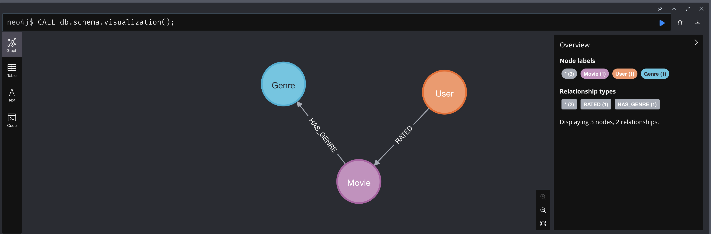

### 1. Які сутності стали вузлами, а які — ребрами? Чому?

Я йшла від питань, які ставитиму графу, а не від структури файлів.
Вузлами стали «іменники», у яких є власна ідентичність і до яких я хочу приходити з різних боків: **User**, **Movie** і **Genre**. Через фільм я переходжу від одного користувача до іншого (запити 3, 5, 6), через жанр — від фільму до інших фільмів і до агрегатів по жанру (запити 1, 4).
Ребрами стали «дієслова», які лише пов'язують дві сутності: користувач **оцінив** фільм (`RATED`), фільм **має** жанр (`HAS_GENRE`). Окремої «таблиці зв'язку» movie_genres, як у SQL, тут немає: її роль виконує саме ребро.

### 2. Оцінка — ребро `(User)-[:RATED]->(Movie)` чи вузол `(:Rating)`?

Я обрала **ребро з властивостями `{rating, timestamp}`**.

За ребро:
- оцінка в MovieLens — це рівно «хто + що + скільки + коли». Своїх зв'язків з іншими сутностями в неї немає, тому вистачає ребра з властивостями;
- обхід коротший: користувач → фільм — 1 хоп замість 2. «Користувач — фільм — користувач» — це 2 хопи замість 4, і для рекомендацій та пошуку шляхів це суттєво;
- менше даних: 1 млн ребер замість 1 млн додаткових вузлів **плюс** 2 млн ребер до них;
- у Neo4j 5 можна індексувати властивості ребер (`CREATE INDEX ... FOR ()-[r:RATED]-() ON (r.rating)`), тож аргумент «на вузлі легше індексувати» вже не працює.

Чому вузол теж міг би бути правильним:
- якби одна людина могла оцінювати той самий фільм кілька разів і ми хотіли б зберігати історію, MERGE по ребру перезаписував би оцінку. З вузлами `Rating` кожна оцінка була б окремим об'єктом;
- якби до оцінки треба було чіпляти інші сутності (текст рецензії як окремий вузол, теги, пристрій, «лайки» на рецензію), то оцінка стала б «проміжною сутністю з власними зв'язками» і заслуговувала б на вузол;
- на вузол `Rating` можна посилатися ззовні, на ребро — ні.

У MovieLens 1M одна пара «користувач–фільм» має рівно одну оцінку (я це перевірила запитом на дублі в частині 2), і додаткових зв'язків немає. Тому ребро тут простіше і швидше.

### 3. Чому жанри — окремі вузли `(:Genre)`, а не список у `Movie`?

- **Один жанр = один вузол.** `Comedy` існує один раз, а не 1 200 разів як рядок у властивостях. Помилка на кшталт «Childrens» замість «Children's» фізично не може з'явитися поруч з правильним жанром: constraint на `Genre.name` + `MERGE`.
- **Запити стартують з жанру.** `MATCH (:Genre {name:'Thriller'})<-[:HAS_GENRE]-(m)` — це пошук одного вузла по індексу, а потім лише його 492 ребра. Зі списком довелося б писати `WHERE 'Thriller' IN m.genres` і перебрати всі 3 883 фільми: членство в списку звичайний індекс не прискорює.
- **Агрегація по жанру природна** (запит 4): групуємо по вузлу `g`, а не розгортаємо `UNWIND` списків у кожному запиті.
- **Граф стає зв'язнішим.** З'являються шляхи «фільм → жанр → схожі фільми». Крім того, на жанр можна навісити свої властивості: опис або той самий денормалізований середній рейтинг.

Ціна цього рішення: жанри стають хабами. Через `Drama` або `Comedy` проходить левова частка всіх оцінок (див. частину 4).

---

## Частина 2 — Завантаження даних

Файл: [`queries/part2_load.cypher`](queries/part2_load.cypher).

**Підготовка (`convert.py`).** Файли мають роздільник `::` і кодування Latin-1. Конвертую в CSV з `,` і UTF-8, бо `LOAD CSV` читає UTF-8. Назви з комою (`"Close Shave, A (1995)"`) `csv.writer` бере в лапки сам, тож колонки не з'їжджають. Кількість рядків звіряю з README датасету: 3 883 / 6 040 / 1 000 209.

| # | Запит | Що робить і чому так |
|---|---|---|
| 1 | Користувачі: `LOAD CSV ... MERGE (u:User {userId}) SET ...` | `MERGE` замість `CREATE` — повторний запуск скрипту не створює дублів. `toInteger()` обов'язковий: LOAD CSV читає все як текст, і `{userId: "1"}` не збігся б з `{userId: 1}`. У `MERGE` тільки ключ `userId`, решта властивостей іде через `SET`: якщо покласти всі властивості в `MERGE`, то при зміні будь-якої з них повторний запуск створив би дубль замість оновлення. 6 040 рядків — одна транзакція, батчі не потрібні. |
| 2 | Фільми та жанри: `LOAD CSV ... MERGE (m:Movie) ... UNWIND split(row.genres,'\|') ... MERGE (g:Genre) MERGE (m)-[:HAS_GENRE]->(g)` | Рік беру з назви (`Toy Story (1995)`): усі назви закінчуються на `(YYYY)`, тому `substring(title, size(title) - 5, 4)`. Жанри приходять рядком `A\|B\|C`: `split` + `UNWIND` дають окремий рядок на кожен жанр, а `MERGE` лишає один вузол на жанр (18 вузлів, 6 408 ребер `HAS_GENRE`). |
| 3 | Індекси: `CREATE CONSTRAINT ... IS UNIQUE` для `User.userId`, `Movie.movieId`, `Genre.name`; `CREATE INDEX` на `RATED.rating` і `Movie.title` | Створюю **до** завантаження ребер: кожен із 1 млн рядків оцінок шукає свого користувача і свій фільм через `MATCH`, і з індексом це один пошук замість перебору всіх вузлів. Uniqueness constraint — це індекс плюс гарантія, що дубль вузла не з'явиться. `IF NOT EXISTS` — щоб скрипт можна було запускати повторно. Індекс на `r.rating` — бо більшість запитів частини 3 фільтрує оцінки (`= 5`, `>= 4`); на `title` — у частині 4 фільми шукаються за назвою. |
| 4 | Ребра: `apoc.periodic.iterate(LOAD CSV ..., MATCH u, MATCH m, MERGE (u)-[r:RATED]->(m) SET ..., {batchSize:10000, parallel:false})` | 1 млн ребер однією транзакцією впали б через таймаут або пам'ять. Перший запит лише читає CSV, другий виконується батчами по 10 000 рядків — ~100 невеликих транзакцій. Вузли вже створені, тому `MATCH` по індексу; для ребра `MERGE` — повторний запуск не дублює оцінки. `parallel: false`: у тілі є `MERGE`, а популярні фільми (у American Beauty 3 428 оцінок) кілька потоків блокували б одночасно. |
| 5 | Перевірка: `count` для `User`, `Movie`, `RATED` | Звіряю з README датасету: 6 040 / 3 883 / 1 000 209. |

Результат перевірки:

| Що | Очікувано | У мене |
|---|---|---|
| Users | 6 040 | 6 040 |
| Movies | 3 883 | 3 883 |
| RATED | 1 000 209 | 1 000 209 |

Завантаження ребер: 101 батч, `total` = 1 000 209, `committedOperations` = 1 000 209, `failedOperations` = 0, `timeTaken` = 21 с.

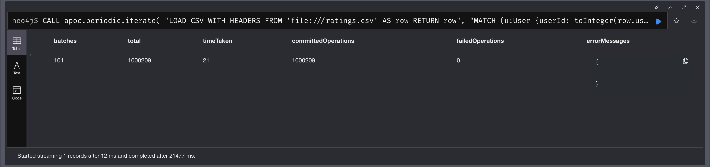

---

## Частина 3 — Запити

Файл: [`queries/part3.cypher`](queries/part3.cypher). Очікувані результати я окремо перерахувала з сирих `.dat` у pandas, щоб було з чим звірити відповіді Neo4j.

### Запит 1. Thriller із середнім рейтингом > 4.0

Стартую з одного вузла `Genre {name:'Thriller'}` (пошук по індексу) і йду лише по його 492 фільмах та їхніх оцінках. Групую по фільму, рахую `avg` і `count`.
Я додала поріг **`numRatings >= 50`**. Без нього фільм з однією-двома «п'ятірками» мав би середнє 5.0 і виглядав би «найкращим трилером», хоча це просто мала вибірка. На цих даних поріг відсікає лише 1 фільм із 52 (*Spiral Staircase, The*, 43 оцінки), але він робить запит коректним і для інших жанрів.

Результат: **51 фільм**. Топ: *Close Shave, A* (4.521 / 657 оцінок), *Usual Suspects, The* (4.517 / 1 783), *Rear Window* (4.476 / 1 050).
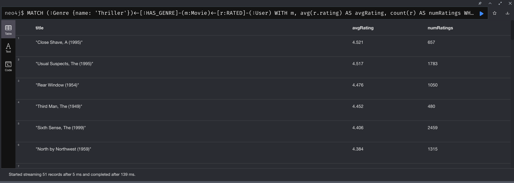

### Запит 2. Користувачі з > 50 оцінками «5»

`WHERE r.rating = 5` стоїть **до** `count`, тому рахуються лише п'ятірки. Потім фільтр `> 50` по вже агрегованому значенню — це аналог `HAVING` у SQL. Запит повертає всіх таких користувачів; їхню кількість Neo4j Browser показує внизу результату.

Результат: **1 390 користувачів**. Рекордсмен — user 4277 (571 п'ятірка), далі 4169 (476) і 3032 (466).
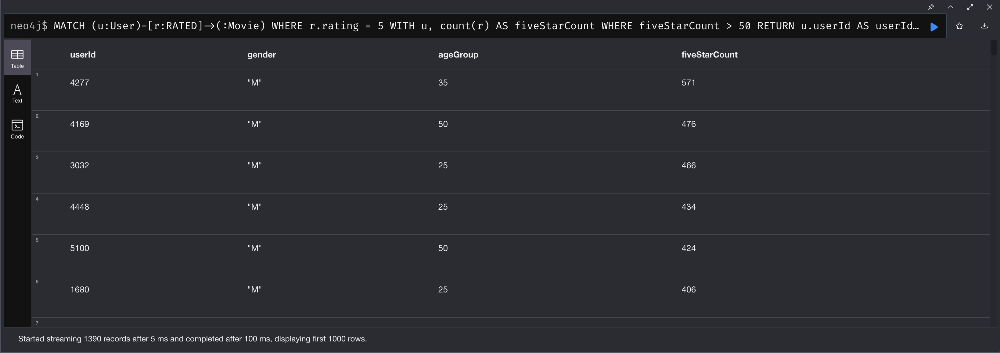

### Запит 3. Фільми, які користувачі 1 і 2 оцінили на ≥ 4

Один патерн-«трикутник» `u1 → m ← u2`. Обидва користувачі знаходяться по індексу, а Neo4j просто перетинає їхні ребра: жодного JOIN по таблиці з мільйоном рядків.

Результат: **6 фільмів**: One Flew Over the Cuckoo's Nest (5/5), Awakenings (5/4), Saving Private Ryan (5/4), Dead Poets Society (4/5), Driving Miss Daisy (4/5), To Kill a Mockingbird (4/4).
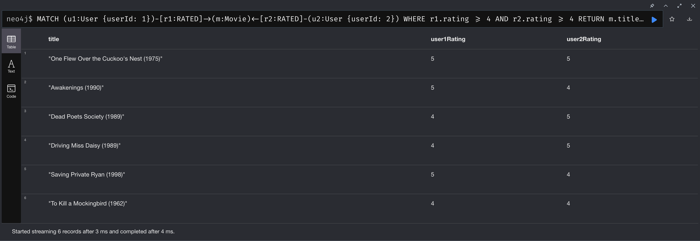

### Запит 4. Жанри зі стабільно високими оцінками

«Стабільно» я зрозуміла як «високо і без великого розкиду», тому рахую одразу чотири метрики: середнє, кількість оцінок, стандартне відхилення `stDev` і частку оцінок ≥ 4 (`pctHigh`). Поріг `numRatings >= 1000` формальний (найменший жанр має 7 910 оцінок), але захищає від випадкових лідерів. Фільм з кількома жанрами враховується в кожному з них, і це свідомо: *Fargo* — і кримінал, і драма, і трилер.

| Жанр | avg | оцінок | stDev | ≥ 4, % |
|---|---|---|---|---|
| Film-Noir | 4.075 | 18 261 | 0.933 | 76.3 |
| Documentary | 3.933 | 7 910 | 1.033 | 72.3 |
| War | 3.893 | 68 527 | 1.065 | 69.4 |
| Drama | 3.766 | 354 529 | 1.046 | 64.4 |
| … | | | | |
| Horror | 3.215 | 76 386 | 1.226 | 44.6 |

Цікаво, що в Film-Noir одночасно найвище середнє і **найменший** розкид: його оцінюють стабільно високо. Horror навпаки: найнижче середнє і найбільший розкид, тобто жанр «на любителя». Нішеві жанри (Film-Noir, Documentary) ймовірно дивляться ті, хто їх свідомо обирає, тому оцінки вищі. Масові Comedy й Action дивляться всі підряд.
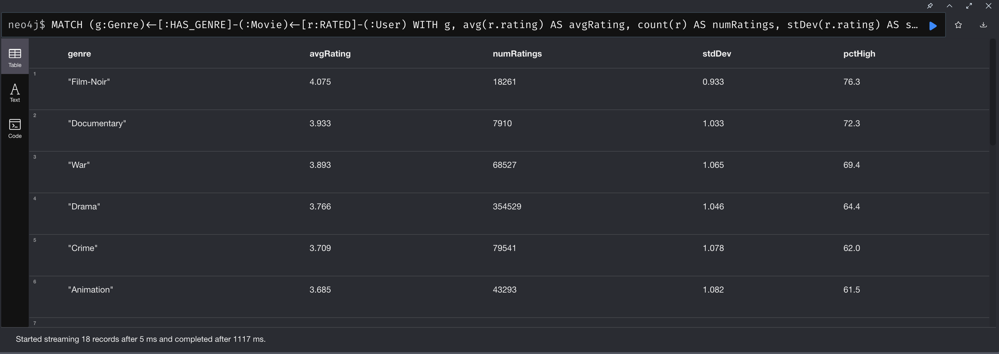

### Запит 5. «Користувачі зі схожими смаками також дивилися»

Колаборативна фільтрація в два кроки:
1. **Сусіди.** Беру фільми, які user 1 оцінив на ≥ 4 (таких 45), і користувачів, які ці ж фільми теж оцінили на ≥ 4. `sharedLikes` — кількість спільних «лайків». Лишаю 25 найсхожіших. Тай-брейк `other.userId` потрібен, бо на межі кілька користувачів мають однакову кількість (31), і без нього результат міг би відрізнятися від запуску до запуску.
2. **Кандидати.** Беру фільми, які сусіди оцінили на ≥ 4, а user 1 ще не оцінював (`NOT (target)-[:RATED]->(rec)`). Сортую за тим, скільки сусідів «рекомендують» фільм, далі за їхньою середньою оцінкою.

`LIMIT 25` між кроками — це не лише «топ сусідів», а й захист від вибуху обходу: без нього другий крок пішов би по фільмах тисяч користувачів.

Результат (топ): *Silence of the Lambs* (24 сусіди, 4.92), *It's a Wonderful Life* (24, 4.88), *Shawshank Redemption* (24, 4.75), *Star Wars V* (23), *Forrest Gump* (23), *Babe* (23)…
Мінус, який я бачу: у списку багато загальновідомих хітів. Найсхожішими виходять «всеїдні» користувачі з тисячами оцінок: у них просто більше шансів перетнутися з будь-ким. Як це виправити — у частині 4 (крок 7) і частині 6.
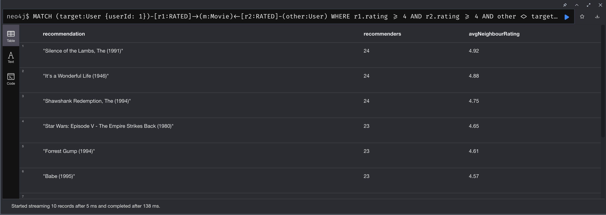

### Запит 6. Найкоротший ланцюжок між двома користувачами

`shortestPath((a)-[:RATED*..10]-(b))` — двонаправлений пошук у ширину лише по ребрах `RATED` і без напрямку. Тип ребра обмежую навмисно: шлях `User–Movie–Genre–Movie–User` теж має довжину 4, але означає «дивилися фільми одного жанру», а це вже інше питання.

| Пара | Довжина | Що це означає |
|---|---|---|
| 1 і 2 | **2** | є спільний фільм |
| 4 і 47 | **4** | спільного фільму немає; ланцюжок: User 4 → *King Kong (1933)* → User 195 → *GoodFellas (1990)* → User 47. User 195 оцінив і фільм користувача 4, і фільм користувача 47 — він «посередник» (запит виконався за 40 мс) |

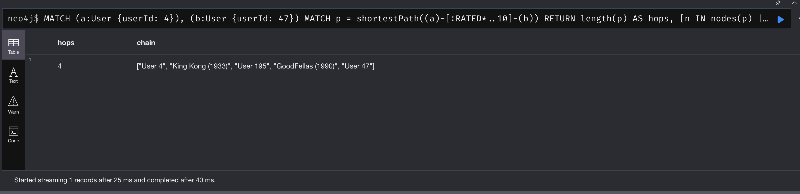

**Що означає довжина шляху?** Граф дводольний: ребра `RATED` з'єднують лише User і Movie. Тому шлях між двома користувачами завжди має **парну** довжину і чергує «користувач — фільм — користувач — …».
- **2**: обидва оцінили той самий фільм. Прямий спільний досвід.
- **4**: `A – фільм X – C – фільм Y – B`. Спільних фільмів у A і B немає, але є «посередник» C, який дивився щось з фільмів A і щось з фільмів B. Це аналог «друга друга».
- **6**: два посередники. Смаки A і B майже не перетинаються, і зв'язок дуже опосередкований.

На цьому датасеті «світ» дуже тісний. За моєю вибіркою з 20 000 випадкових пар **~96 % пар мають спільний фільм** (довжина 2), решта ~4 % з'єднуються через одного посередника (довжина 4). Навіть для пари 4 і 47, які оцінили лише по ~20 фільмів і не мають жодного спільного, знайшлося 4 739 можливих посередників. Шляхи довжини 6 мені не трапилися. Причина в блокбастерах: фільм з 3 000 оцінок з'єднує напряму половину бази.

---

## Частина 4 — Супервузли

Файл: [`queries/part4_supernodes.cypher`](queries/part4_supernodes.cypher).

| Крок | Що робить |
|---|---|
| 1 | Ступінь кожного вузла через `COUNT { (n)--() }` (синтаксис Neo4j 5 замість застарілого `size((n)--())`), топ-20. |
| 2 | Розподіл ступенів по лейблах: середнє, медіана, 99-й перцентиль, максимум. Так видно, що «аномально» — це відносно до типового вузла свого типу. |
| 3 | Супервузли за правилом «ступінь > 10 × медіана лейбла» (медіана рахується в самому запиті). |
| 4 | Жанри: пряма кількість фільмів і кількість оцінок «за» жанром (2 хопи). |
| 5 | `PROFILE` однакового запиту для супервузла і звичайного фільму. |
| 6–7 | Денормалізація агрегатів і фільтр блокбастерів до обходу. |

### 1. Які вузли виявилися супервузлами? Скільки у них зв'язків?

| Лейбл | Медіана | p99 | Максимум |
|---|---|---|---|
| Movie | 111 | 1 785 | **3 430** — *American Beauty* |
| User | 96 | 909 | **2 314** — user 4169 |
| Genre | 211 | 1 603 | **1 603** — *Drama* |

Топ-20 всього графа — це 19 фільмів і 1 користувач: *American Beauty* 3 430, *Star Wars IV* і *V* по 2 995, *Star Wars VI* 2 888, *Jurassic Park* 2 675, …, user 4169 — 2 314 (він оцінив понад 60 % усіх фільмів, що мають хоч одну оцінку).
За правилом «> 10 × медіани» супервузлами є **165 фільмів** (> 1 110 ребер) і **48 користувачів** (> 960). Розподіл має «довгий хвіст»: половина фільмів має до 111 оцінок, а топ — у 30 разів більше.

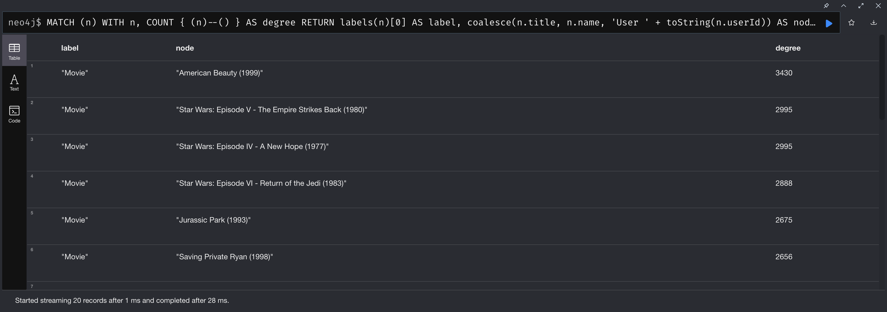

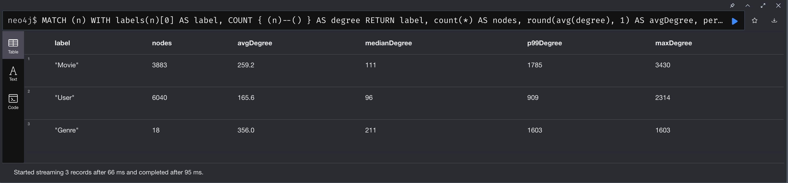

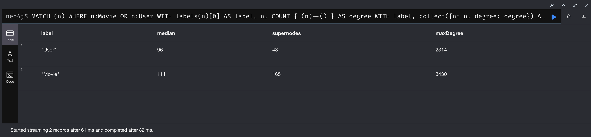

### 2. Чому запит через такий вузол повільніший, хоча індекси ті самі?

Індекс прискорює лише **пошук стартового вузла**: `Movie {title:'American Beauty (1999)'}` і `Movie {title:'Basquiat (1996)'}` знаходяться однаково швидко. Але далі Neo4j йде по ребрах вузла (index-free adjacency). Ребра вузла зберігаються як ланцюжок, і обійти 3 428 ребер — у ~27 разів більше роботи, ніж 127 ребер звичайного фільму. Індекс тут нічим не допоможе: він не вирішує, *скільки* ребер треба прочитати.

Ще гірше на кількох хопах: кожен хоп **множить** кількість рядків. `American Beauty ← користувачі → їхні фільми` дає 714 252 проміжні шляхи. Будь-який запит виду «схожі користувачі» або «що ще дивилися», який проходить через блокбастер, роздувається саме в ньому.

Мої результати PROFILE:

| Запит | Ребер / рядків | Час |
|---|---|---|
| American Beauty (1999) ← RATED | 3 428 оцінок | 63 мс |
| Basquiat (1996) ← RATED | 127 оцінок | 13 мс |
| American Beauty ← RATED – User – RATED → Movie (2 хопи) | 714 252 шляхи | 197 мс |

Пошук обох фільмів по індексу однаковий, а різниця в часі (63 мс проти 13 мс) — це обхід ребер. На двох хопах через супервузол рядків стає у ~200 разів більше, ніж ребер у самого вузла.
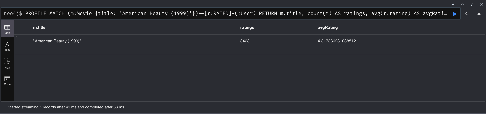

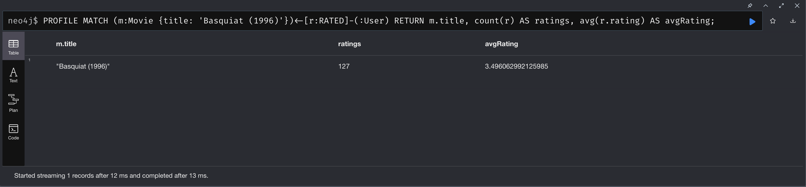

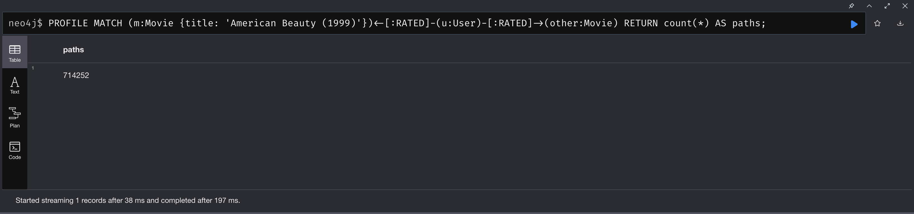

### 3. Яку стратегію з лекцій я б застосувала? Що з жанрами?

**Жанри теж супервузли, але не за кількістю ребер, а за тим, куди вони ведуть.** У *Drama* «лише» 1 603 ребра (менше, ніж у *American Beauty*), але через нього за 2 хопи доступно 354 529 оцінок. Фільми з Drama або Comedy разом мають ~64 % усіх оцінок бази. Тобто будь-який запит «жанр → фільми → оцінки» (запит 4) фактично сканує більшу частину бази.

Що я б робила:

1. **Денормалізація — зберегти агрегати на вузлах.** Порахувати один раз `m.avgRating`, `m.ratingCount` на фільмі, `u.ratingCount` на користувачі. Запит 1 після цього взагалі не читає ребер `RATED`: жанр → 492 фільми → фільтр по властивостях. Те саме можна зробити з агрегатами на вузлі `Genre` для запиту 4. MovieLens — статичний датасет, тому головний мінус цього підходу («треба тримати лічильник актуальним») тут майже не заважає. При нових оцінках лічильник можна оновлювати тригером `apoc.trigger`.
2. **Фільтр до входу в супервузол.** У рекомендаціях блокбастери одночасно найдорожчі і найменш інформативні: Star Wars люблять майже всі, тож спільна «п'ятірка» йому мало каже про схожість смаків. Відсікаю їх по проіндексованому `m.ratingCount <= 1000` ще **до** розгортання їхніх ребер. Бонус: рекомендації для user 1 стають персональнішими. З'являються *Pinocchio*, *Lady and the Tramp*, *Sleeping Beauty*, тобто видно, що user 1 любить класичну анімацію, а не «просто хіти».
3. **Для жанрів — розбиття на менші проміжні вузли.** Якщо жанрові агрегати треба рахувати «наживо», можна ввести проміжні вузли `(:Movie)-[:HAS_GENRE]->(:GenreDecade {genre:'Drama', decade:1990})-[:PART_OF]->(:Genre)`. З 1 603 драм 1 036 — з 1990-х, тож запит «драми 90-х» перестане проходити через весь жанр. Простіше рішення — **додаткові лейбли** `:Movie:Drama` для фільтрації: тоді для простого фільтра по жанру вузол-хаб взагалі не потрібен. А в рекомендаціях я б **не будувала схожість через жанр** (`User–Movie–Genre–Movie`): 2 хопи через *Drama* — це половина бази, а сигналу майже нуль.

Мій результат: запит 1 у початковому вигляді (обходить ~190 тис. оцінок трилерів) виконався за **122 мс**, денормалізована версія (лише `m.avgRating` і `m.ratingCount` на 492 фільмах) — за **9 мс**. Результат однаковий — ті самі 51 фільм, а запит став приблизно у 13 разів швидшим.

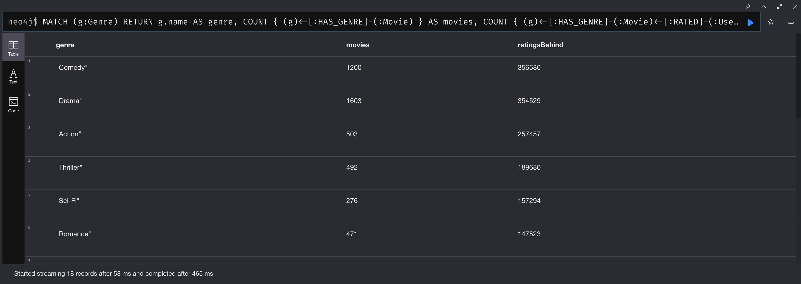

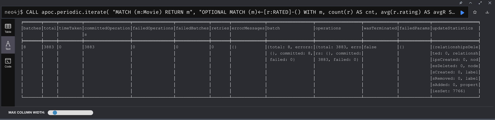

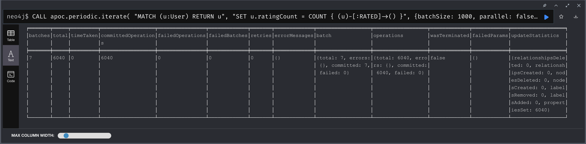

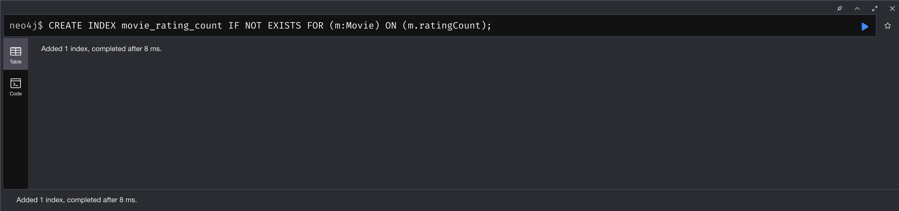

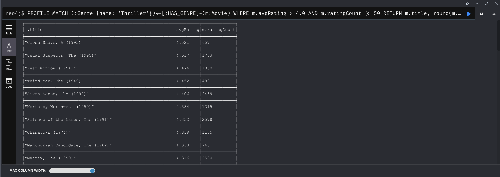

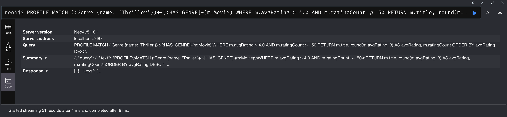

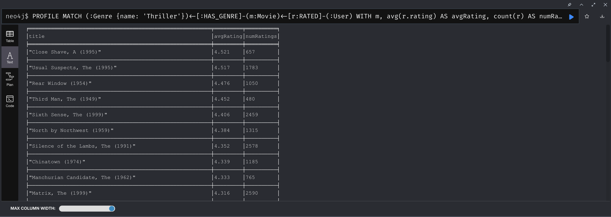

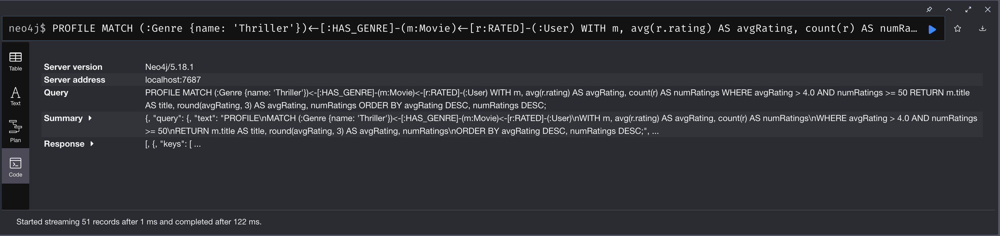


---

## Частина 5 — GDS (додаткова)

Додаткова частина не виконувалась (за умовою вона не оцінюється і не впливає на прийняття роботи).

---

## Частина 6 — Аналіз і висновки

### 1. Граф vs SQL

У реляційній моделі це три таблиці: `users`, `movies`, `ratings(user_id, movie_id, rating, ts)` і ще `movie_genres(movie_id, genre)`.

Запити 1–4 у SQL пишуться легко: це `JOIN` + `GROUP BY` + `HAVING`, і SQL тут почувається не гірше за Cypher. Складність починається із запитами 5 і 6.

**Запит 5** в SQL можливий, але це три самоз'єднання таблиці з мільйоном рядків:

```sql
WITH neighbours AS (
  SELECT r2.user_id AS other, COUNT(*) AS shared_likes
  FROM ratings r1
  JOIN ratings r2 ON r2.movie_id = r1.movie_id
                 AND r2.user_id <> r1.user_id AND r2.rating >= 4
  WHERE r1.user_id = 1 AND r1.rating >= 4
  GROUP BY r2.user_id
  ORDER BY shared_likes DESC, other
  LIMIT 25
)
SELECT m.title, COUNT(DISTINCT n.other) AS recommenders, AVG(r3.rating) AS avg_rating
FROM neighbours n
JOIN ratings r3 ON r3.user_id = n.other AND r3.rating >= 4
JOIN movies m   ON m.movie_id = r3.movie_id
WHERE NOT EXISTS (SELECT 1 FROM ratings x WHERE x.user_id = 1 AND x.movie_id = r3.movie_id)
GROUP BY m.title
ORDER BY recommenders DESC, avg_rating DESC
LIMIT 10;
```

Він працює, але логіка «пройти від мене через фільми до людей і назад до фільмів» розмазана по `JOIN ... ON` умовах. Кожен `JOIN` — це пошук по індексу у великій таблиці, а не перехід по готовому вказівнику. У Cypher той самий запит читається як картинка: `(me)-[:RATED]->(m)<-[:RATED]-(other)-[:RATED]->(rec)`.

**Запит 6** — найкращий приклад. Ми **не знаємо наперед довжину шляху**, а SQL-запит з `JOIN` має фіксовану кількість з'єднань. Доводиться писати рекурсивний CTE:

```sql
WITH RECURSIVE walk(user_id, depth, path) AS (
  SELECT 1, 0, ARRAY[1]
  UNION ALL
  SELECT r2.user_id, w.depth + 1, w.path || r2.user_id
  FROM walk w
  JOIN ratings r1 ON r1.user_id = w.user_id
  JOIN ratings r2 ON r2.movie_id = r1.movie_id AND r2.user_id <> ALL(w.path)
  WHERE w.depth < 3
)
SELECT MIN(depth) * 2 AS hops FROM walk WHERE user_id = 47;
```

Формально він існує, але на практиці непридатний. Він іде в ширину лише з одного боку, не зупиняється, коли знайшов ціль, і на кожному рівні множить рядки. Вже перший крок від користувача з 20 фільмів через блокбастери дає тисячі людей, а другий — мільйони рядків з масивами шляхів. `shortestPath` у Neo4j іде двонаправленим BFS з обох кінців і зупиняється на першій зустрічі. Тому в графі це запит на мілісекунди, а в SQL — задача, яку довелося б виносити в окремий код.

### 2. Де граф програє

Граф виграє, коли відповідь — це **локальний обхід** від кількох стартових вузлів. Він програє, коли треба **пройтися по всьому** і порахувати:
- **глобальні агрегації і звіти.** Запит 4 по суті сканує майже всі 1 млн оцінок. Звіт «середня оцінка по вікових групах × жанрах × роках» або «кількість оцінок за місяць» — це класичний `GROUP BY`. Колонкова SQL-база (PostgreSQL, а ще краще ClickHouse/BigQuery) зробить його швидше і з меншою пам'яттю: вона читає лише потрібні колонки, а Neo4j ходить по записах вузлів і ребер;
- **часові ряди по `timestamp`.** У графі це лише властивість на ребрі, і індекс по ній не робить запит «обходом»;
- **експорт і інтеграція.** Вивантажити таблицю `ratings` у CSV або для ML-пайплайна (pandas, sklearn) простіше з SQL: дані вже лежать таблицею;
- **масові оновлення і завантаження.** Мені довелося батчити 1 млн ребер через APOC. В SQL `COPY ratings FROM 'ratings.csv'` — одна команда;
- **місце на диску.** Кожне ребро зберігає вказівники на сусідні ребра обох вузлів, тож той самий мільйон оцінок займає більше, ніж компактна таблиця з чотирьох цілих чисел.

### 3. Покращення схеми

1. **Запити 1 і 4 → денормалізовані агрегати.** `m.avgRating`, `m.ratingCount` на `Movie` (вже зроблено в частині 4, крок 6) і так само `avgRating`, `ratingCount`, `stdDev` на `Genre`. Запит 1 перестає читати ребра `RATED` зовсім. Запит 4 перетворюється на `MATCH (g:Genre) RETURN g.name, g.avgRating ...`, тобто на 18 вузлів замість мільйона ребер. Ціна — оновлювати агрегати при нових оцінках.
2. **Запит 5 → спеціалізація типу ребра + матеріалізована схожість.**
   - Розбити `RATED` за значенням: окремий тип `:LIKED` для оцінок ≥ 4 (або додати його паралельно). У Neo4j «щільні» вузли (з > 50 ребрами) зберігають ребра згрупованими за типом і напрямком. Тоді обхід `[:LIKED]` у *American Beauty* не читає зайві ребра з низькими оцінками, а фільтр `r.rating >= 4` зникає з запиту.
   - Заздалегідь (вночі, батчем) рахувати ребра `(:User)-[:SIMILAR {weight}]->(:User)` для k найсхожіших (заздалегідь розраховані ребра схожості). Тоді рекомендація — це 2 хопи `me → SIMILAR → other → LIKED → rec` замість 3 хопів з агрегацією через супервузли під час запиту.
3. **Запит 2 → лічильник на користувачі.** `u.fiveStarCount` + range-індекс: «користувачі з > 50 п'ятірками» стає пошуком по індексу без читання жодного ребра.
4. **Запит 6** у поточній схемі і так швидкий. Але якщо питати «наскільки схожі люди», а не «чи є зв'язок», то шлях краще шукати по графу `SIMILAR`, а не по `RATED`. Блокбастери роблять граф `RATED` «тісним» майже для всіх, і довжина шляху там мало що означає.

---

## Висновки

Найбільше мене здивувало, що в графі дорогий не пошук вузла, а обхід його ребер: American Beauty знаходиться так само швидко, як Basquiat, але запит до нього в кілька разів повільніший. Також я не очікувала, що жанр Drama з «лише» 1 603 ребрами через 2 хопи тягне за собою 354 тис. оцінок. Проста денормалізація (збережені `avgRating` і `ratingCount`) прискорила запит 1 з 122 до 9 мс. Граф я б обрала для рекомендацій і пошуку зв'язків, а для звітів і агрегацій по всій базі — SQL.